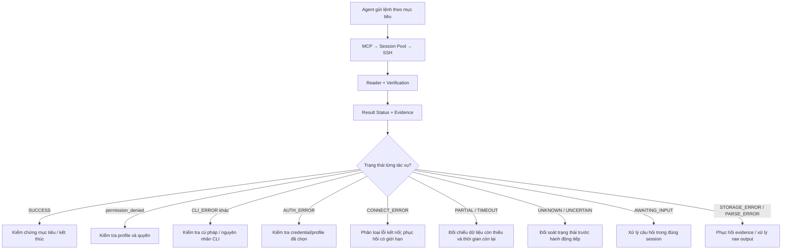

# Agent workflow — Netmiko MCP 1.9.1

Áp dụng khi agent dùng Netmiko MCP để đọc hoặc cấu hình thiết bị. Backend thực thi, đọc CLI và trả bằng chứng; agent xác định mục tiêu đã đạt hay cần xử lý tiếp. Đây là hướng dẫn cho agent, không phải bộ điều phối chạy trong backend và không thêm MCP tool.

## Luồng xử lý



Sau hành động phục hồi hoặc kiểm chứng, đọc lại kết quả theo cùng quy trình. Không tạo vòng thử vô hạn. CANCELLED kết thúc việc chạy; không tự khởi động lại.

## Batch độc lập và SKIPPED

- Mặc định ssh_execute_many dừng khi một lệnh lỗi. Với các lệnh đã xác định độc lập, agent có thể đặt continue_on_error=true; backend chỉ tiếp tục lỗi CLI có prompt/output đầy đủ và session đồng bộ. Không dùng để bỏ qua mất kết nối, timeout, câu hỏi hay tác động cấu hình chưa rõ.
- SKIPPED nghĩa là lệnh chưa gửi do batch đã dừng, không phải thiết bị trả lỗi. Xem blocked_by_command_index để tìm lệnh gây dừng, giữ nguyên lỗi và evidence của lệnh đó. Không kết luận dữ liệu rỗng từ lệnh SKIPPED; không báo toàn batch thành công nếu có CLI_ERROR/SKIPPED.
- Không tự retry batch có cấu hình; scanner vẫn dùng mặc định dừng và resume theo prefix đã kiểm chứng.

## 1. Đọc kết quả trước khi quyết định

- Xem `status`, `fault_status`, `error_category`, `error_stage`, `error_reason`, `retryable`, `command_sent`, `replay_safe`, `execution_state`, `output_complete`, `data_state` khi các field này có mặt. Không suy ra thành công chỉ từ prompt, SSH login hoặc một phần output.
- Với batch/parallel/interact, đọc từng phần tử `results`/`steps`, `status_counts`, `awaiting_tasks` và `awaiting_task_ids`. `PARTIAL` tổng có thể gồm task thành công, task lỗi, task chờ và cấu hình chưa rõ kết quả. Không retry toàn batch hoặc chạy lại task thành công.
- Nếu `execution_state=UNCERTAIN`, ưu tiên đối soát trước mọi nhánh phục hồi khác, kể cả khi `fault_status=TIMEOUT` hay `CLI_ERROR`. Với lệnh có tác động đã gửi, thiếu phản hồi không chứng minh lệnh chưa thực hiện.
- Bản cũ có thể không có `error_reason`; dùng lỗi và evidence để đánh giá, không tự gán thiếu quyền chỉ vì `CLI_ERROR`.
- Các tool đọc/search file và inventory/status có response riêng, không phải mọi tool đều có status thực thi SSH. Không ép kết quả file đọc thành một lỗi kết nối thiết bị.

Ví dụ lỗi thiếu quyền sau khi SSH thành công:

```json
{
  "ok": false,
  "status": "CLI_ERROR",
  "error_category": "cli_error",
  "error_reason": "permission_denied",
  "error_stage": "cli",
  "transport_ok": true,
  "output_complete": true,
  "retryable": false
}
```

Ở đây `output_complete=true` nghĩa là đã đọc trọn phản hồi từ chối; không có nghĩa đã lấy được dữ liệu người dùng cần. `data_state=FULL` cũng không biến lỗi quyền thành kết quả thu thập hợp lệ.

## 2. Hành động theo nguyên nhân

| Kết quả / bằng chứng | Agent xử lý |
| --- | --- |
| SUCCESS | Đối chiếu dữ liệu với mục tiêu; kết thúc nếu đủ. Với cấu hình, kiểm chứng trạng thái sau thay đổi bằng lệnh đọc phù hợp khi cần. |
| CLI_ERROR + permission_denied | Phân biệt quyền thực thi lệnh, quyền file, quyền sudo/enable hoặc AAA theo evidence. Kiểm tra profile/mode đúng. Chỉ chuyển sang profile phù hợp đã biết trong phạm vi tác vụ; không thử hàng loạt tài khoản, không reconnect cùng tài khoản chỉ để lặp lại từ chối. |
| CLI_ERROR + syntax_error | Xem câu lệnh, mode, driver và cú pháp hãng. Chỉ sửa theo bằng chứng; không tự đổi credential. Backend không sửa hay lọc lệnh. |
| CLI_ERROR + command_failed hoặc không có reason | Đọc thông báo cụ thể như tài nguyên chưa sẵn sàng, commit failed hoặc điều kiện vận hành. Không mặc định là thiếu quyền hay sai driver. |
| AUTH_ERROR | Kiểm tra mapping profile, username và phương thức password/key/agent. Chỉ chuyển profile khi có căn cứ profile hiện tại sai và profile thay thế phù hợp; không đoán password, không bỏ qua cooldown bằng một chuỗi login lặp. |
| CONNECT_ERROR | Phân biệt DNS, refused, handshake, algorithm và connection_lost. Lỗi tạm thời mới cân nhắc phục hồi; lỗi địa chỉ hoặc tương thích cần căn cứ để sửa. Không coi mọi connect error đều retry được. |
| TIMEOUT / PARTIAL / output_verification | Xem lỗi ở connect/auth/reader hay verification; giữ dữ liệu dở dang. Kiểm tra pager, prompt, output dài, ngân sách và phần còn thiếu. Không tăng timeout hàng loạt, không suy ra dữ liệu rỗng hay thiết bị down. Chỉ chạy lại lệnh đọc khi phù hợp và không retry chồng. |
| AWAITING_INPUT | Giữ target/profile/driver của session; dùng ssh_interact để gửi phản hồi đúng câu hỏi trong phạm vi tác vụ đã được yêu cầu. Không tự gửi Enter/yes/exit để làm biến mất câu hỏi. Nếu thiếu thông tin quyết định thì hỏi rõ. |
| UNKNOWN / UNCERTAIN | Giữ evidence, xác định lệnh nào đã gửi; dùng truy vấn trạng thái để đối soát trước. Không tự replay cấu hình, commit/save hoặc batch có tác động chưa rõ. |
| STORAGE_ERROR | Nếu raw output còn, đọc/xuất lại evidence. Scanner export_pending có thể phục hồi qua resume mà không SSH. Chỉ lỗi lưu file không phải lý do chạy lại cấu hình. Nếu raw đã mất, báo giới hạn evidence rõ ràng. |
| PARSE_ERROR | Dùng raw output/evidence để đọc hoặc sửa parser. Không coi parser lỗi là không có tài khoản/dữ liệu; không SSH lại nếu raw đã đủ. |
| CANCELLED | Giữ kết quả đã có và dừng; không tự tiếp tục tác vụ đã bị hủy. |

## 3. Tránh retry chồng và mất context

- Xem `previous_attempt`, `recovery_attempts`, lịch sử attempt và checkpoint trước khi phục hồi. Backend execute đơn đã có recovery cho mất transport của một số lệnh đọc; scanner tự sở hữu retry cho batch. Không bọc thêm vòng retry y nguyên khi cơ chế đó đã dùng hết lượt.
- Mỗi tác vụ có ngân sách thời gian/lượt thử hữu hạn. Nếu chưa có retry ở tầng dưới và lỗi thật sự tạm thời, mặc định tối đa một lần phục hồi chủ động, trong ngân sách còn lại; tuân theo ngân sách khác nếu tác vụ đã chỉ định. Hết ngân sách thì báo kết quả, không khởi tạo tool request liên tục để né timeout.
- Dùng resume của cùng plan/job để giữ task thành công và prefix đọc hoàn tất. Không bỏ kiểm chứng identity/evidence. Explicit retry mở chu kỳ mới; chỉ dùng khi có căn cứ, không tự mở lại liên tục.
- `replay_safe` chỉ là phân loại kỹ thuật cho retry, không thay thế việc hiểu tác động của lệnh. Cấu hình chưa rõ kết quả phải được đối soát; `--replay-uncertain` không phải cách xử lý timeout mặc định.
- Khi đang ở config mode hoặc câu hỏi, không chuyển profile giữa chừng và tiếp tục như session cũ. Nếu phải tạo session khác, xác định lại context bằng evidence trước khi tiếp tục.

## 4. Đọc đủ evidence và kiểm chứng mục tiêu

- `preview` hoặc text inline bị cắt không phải toàn bộ output. Có `output_id` thì dùng ssh_read_output theo offset; gặp dòng quá dài dùng ssh_read_output_bytes và `next_byte_offset`, đọc tiếp khi `more=true` nếu cần toàn bộ dữ liệu. Dùng ssh_search_output khi chỉ cần tìm có mục tiêu; không suy ra không tồn tại từ một preview.
- Kiểm chứng cấu hình theo mục tiêu người dùng: ví dụ interface có trạng thái mong muốn, cấu hình đã xuất hiện, commit đã thành công hoặc trạng thái dịch vụ đã thay đổi. Không tự thêm chuỗi commit/save/reload hay thay đổi khác chỉ vì có prompt cuối.
- Với account collector, phân biệt SSH thất bại, thiếu quyền xem, dữ liệu chưa đủ, parser lỗi và thực sự không có tài khoản. Chỉ kết luận không có tài khoản khi truy vấn thành công và dữ liệu đủ.
- Khi chưa kiểm chứng được, báo rõ phần đã thực thi/đã xác nhận và phần chưa xác nhận. Không nâng `UNKNOWN`, `PARTIAL` hoặc thiếu evidence thành SUCCESS trong lời trả lời.

## 5. Phạm vi kiến trúc và sử dụng từ client

Giữ nguyên 10 tools: ssh_execute, ssh_execute_many, ssh_interact, ssh_parallel, ssh_read_output, ssh_read_output_bytes, ssh_search_output, ssh_inventory, ssh_status, ssh_close. Không thêm command filter, ping trước SSH, thử hàng loạt profile, thay pool/semaphore, tăng worker/timeout hoặc autodetect lại khi chưa có bằng chứng lỗi phù hợp.

[AGENTS.md](../AGENTS.md) trỏ tới workflow này. Với client không tự đọc AGENTS.md, đưa AGENTS.md và mcp/WORKFLOW.md vào nguồn instructions/context của agent. Backend không tự nạp Markdown thành logic thực thi; các client cùng dùng một hướng dẫn và 10 tools hiện tại. Không cần framework điều phối mới.

Test phát triển chỉ dùng mock và SSH localhost. Pilot thiết bị thực dùng phạm vi/thiết bị do công việc chỉ định, giữ evidence theo từng thiết bị. Không đưa credential hoặc dữ liệu triển khai riêng vào Git.
